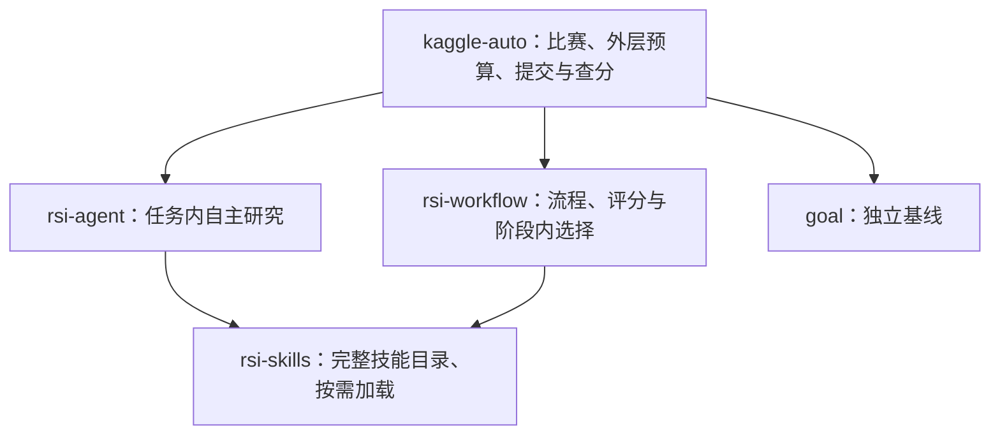

# RSI Skills

## 四仓库架构与兼容性



箭头表示调用 / 依赖方向。框架仓库分别为 [rsi-system-agent](https://github.com/para-rsi/rsi-system-agent)、[rsi-system-workflow](https://github.com/para-rsi/rsi-system-workflow)；对外引擎名为 `rsi-agent` / `rsi-workflow`。共享方法由 [rsi-skills](https://github.com/para-rsi/rsi-skills) 维护，平台入口由 [kaggle-auto](https://github.com/para-rsi/kaggle-auto) 维护。

| 接口边界 | 规范的维护者 | 兼容性验证 |
| --- | --- | --- |
| 技能库 → 两个框架 | rsi-skills 的公开 API、配置、完整目录与冻结快照 | 整库临时安装、发现与按需读取、哈希防篡改、恢复测试 |
| 框架 → 平台入口 | kaggle-auto 的引擎协议 v1：descriptor、TASK、result / candidate | 同一运行时校验器 + check_engine 真实适配器离线执行 |
| 各层运行产物 | 各自产出；kaggle-auto 维护公共产物合同 v1 检查 | manifest、trace、实验索引、提交文件路径 / 哈希 / 身份关联 |
| Workflow 内部 | rsi-workflow 的 Pydantic 模型与导出 JSON Schema | Task / Plan / Execution / Evaluation 校验及 schema 同步检查 |

两个框架**各自**以 `rsi-skills/` submodule 锁定完整库提交，`skills-config.json` 只声明 `library_path: ./rsi-skills` 和 `selection: auto`；uv.lock 锁 Python 依赖。使用独立 Python 环境，允许锁定不同技能版本；对比实验应统一技能提交。先看完整名称 / 描述，再按任务或流程阶段加载正文，不固定技能白名单。框架拥有原生检查点，kaggle-auto 拥有外层原预算和正式 submission_id；`goal` 不依赖 RSI。

原输出目录保持不变，以 manifest 映射身份、版本和证据路径。commit_id 是批次身份，代码 SHA 另记。产物包括 trace、实验索引、提交清单和摘要；未知值、未上报实验、历史缺口须明确标记。恢复沿用原身份、原版本、原截止，升级不替换正在运行的冻结快照。

四库的每次 push / PR 都触发跨仓库 CI，测试当前提交的准确 SHA，结果直接显示在原仓库的 PR。校验实现集中在 kaggle-auto，各库只维护触发入口；上游入口以完整 SHA 锁定校验实现。`pinned` 将当前改动放进固定消费者组合，`candidate` 将当前改动放进候选组合（默认其他库 main）。技能库改动会同时注入两个框架；其余 pinned 检查保留框架各自的技能 gitlink。记录全部实际 SHA，临时覆盖不改正式依赖。稳定汇总检查名为 `RSI compatibility`，任一组合失败即失败；强制阻止合并还需在仓库分支保护中将它设为 required。结构或离线测试通过不代表真实模型、平台网络或比赛效果已经验证。

详细合同及验证命令统一见 [kaggle-auto 兼容性说明](https://github.com/para-rsi/kaggle-auto/blob/main/docs/compatibility.md)。各仓库只维护自己拥有的接口，不复制一套公共协议实现到技能正文。


供 rsi-agent 和 rsi-workflow 共同依赖的轻量技能库：**整库安装、按需加载、多个技能组合使用**。

技能以普通 `SKILL.md` 文件维护。原子技能提供具体方法；组合技能组织方法。首版没有独立 Hub 服务、每个技能的包管理器或新增 Agent 运行循环。

## 技能目录

| 类型 | 技能 | 用途 |
|---|---|---|
| 入口 | [rsi-using-skills](skills/entry/rsi-using-skills/SKILL.md) | 根据任务选择技能并组合使用 |
| 原子 | [rsi-validation-design](skills/atomic/rsi-validation-design/SKILL.md) | 数据划分、特征可用性与泄漏检查 |
| 原子 | [rsi-tabular-modeling](skills/atomic/rsi-tabular-modeling/SKILL.md) | 建立和修改表格回归或分类候选 |
| 原子 | [rsi-error-analysis](skills/atomic/rsi-error-analysis/SKILL.md) | 定位失败与形成改动假设 |
| 原子 | [rsi-experiment-review](skills/atomic/rsi-experiment-review/SKILL.md) | 比较候选、保留失败分母、决定继续或停止 |
| 原子 | [rsi-artifact-check](skills/atomic/rsi-artifact-check/SKILL.md) | 检查产物格式、ID、数值与候选对应关系 |
| 原子 | [rsi-kaggle-open-sota](skills/atomic/rsi-kaggle-open-sota/SKILL.md) | 获取 Kaggle 公开最佳候选、评测方向与带时间的榜单位置估算 |
| 组合 | [rsi-solve-tabular-task](skills/composite/rsi-solve-tabular-task/SKILL.md) | 从验证设计到表格任务交付 |
| 组合 | [rsi-kaggle-optimize](skills/composite/rsi-kaggle-optimize/SKILL.md) | 私有打榜、开源基线复现与改进、Discussion 假设和提交回归 |
| 组合 | [rsi-improve-solution](skills/composite/rsi-improve-solution/SKILL.md) | 根据已有方案与历史组织针对性改进 |
| 组合 | [rsi-kaggle-evolution-analysis](skills/composite/rsi-kaggle-evolution-analysis/SKILL.md) | 依据 Top 开源方案进化链，判断 Kaggle 任务下一步优化方向并产出可验证假设 |

两类技能格式相同。源码按类型分组，安装时展开为十一个独立技能目录。组合技能只引用原子技能；原子技能可以被多个组合复用。

新增 Kaggle 打榜组合 `rsi-kaggle-optimize`：优先复现公开最佳候选，结合 Discussion 形成可验证改动；没有可信改进则回退有效基线。上传和更新保持 private，脚本提供离线回归门禁，远端可见性须由执行工具另行核验。

新增开源方案进化分析组合 `rsi-kaggle-evolution-analysis`：把 Top 公开方案按“基线、验证、数据/先验、互补模型、融合校准、后处理、工程”归档，先判断当前方案所处阶段，再按证据和成本排序优化假设，不默认换更大的模型。

## 依赖与职责

本库发布为 Python 分发包 `rsi-skills`，导入名为 `rsi_skills`，当前 API 版本为 0.2。rsi-agent 保留主 Agent 的研究循环、P/U 方法和经验管理；rsi-workflow 保留步骤调度、评分与预算；两者从本库加载可复用的方法。主 Agent 指令与研究控制保留在 rsi-agent 仓库，不迁入本库。kaggle-auto 在外层分别启动两个框架，Claude Code `/goal` 作为独立基线。

调用方声明 `rsi-skills>=0.2.1,<0.3`，用锁文件固定解析结果。两个框架的 `[tool.uv.sources]` 指向各自 `rsi-skills/` 子模块；部署从兼容的 wheel 或固定 Git 提交安装。不要在任务运行过程中自动拉取或更新依赖。

```python
from rsi_skills import install, open_snapshot

snapshot = install("/path/to/run/skills")
entries = snapshot.entries()  # 只有名称、描述、类型、正文路径和哈希
# 下次恢复直接 open_snapshot("/path/to/run/skills")，沿用原冻结内容。
```

包内包含整库技能及资源。安装 Python 包不注册全局 Agent 技能，也不执行技能脚本。

## 安装全部技能

要求 Python 3.10+，只使用标准库。安装操作不访问网络、不执行技能脚本、不编辑全局运行时配置。

```bash
git clone https://github.com/para-rsi/rsi-skills.git
cd rsi-skills
python3 scripts/skills.py check
./install.sh --target ../rsi-runtime/skills
```

`--target` 必须显式传入，指定实际运行环境的技能目录。示例目标是仓库旁的 `rsi-runtime/skills`，不在源码内。路径有空格时加引号。

安装结果：

```text
rsi-runtime/skills/
├── .rsi-skills.json
├── .rsi-runtime.py
├── rsi-using-skills/SKILL.md
├── rsi-validation-design/SKILL.md
├── rsi-tabular-modeling/SKILL.md
├── rsi-error-analysis/SKILL.md
├── rsi-experiment-review/SKILL.md
├── rsi-artifact-check/SKILL.md
├── rsi-kaggle-open-sota/SKILL.md
├── rsi-solve-tabular-task/SKILL.md
├── rsi-improve-solution/SKILL.md
└── rsi-kaggle-optimize/SKILL.md
```

 `.rsi-skills.json` 记录名称、类型、描述、绝对路径、内容哈希、来源提交及源码是否有未提交改动。它可供 System 发现技能；不是技能实际使用记录。

首次安装拒绝覆盖同名已有目录。相同版本重复安装不产生改动。

## 在同一任务使用多个技能

System 将安装记录中的名称、描述与路径提供给 Agent。使用运行时原生技能加载能力，或读取所选目录的 `SKILL.md`。开始时只提供摘要，随后按当前问题加载正文。

例如，表格任务进入 `rsi-solve-tabular-task`，根据阶段使用验证设计、表格建模、产物检查、错误分析与实验比较。它们共同约束一个任务、一个候选版本和同一份预算。

指定 Kaggle 比赛寻找当前公开最佳方案时，使用 `rsi-kaggle-open-sota`。其标准库脚本读取 Code 列表真实的 `bestPublicScore`，按指标方向合并普通和置顶 Notebook，并用官方 Public 榜单快照估算当前分数位置。输出明确给出“越高越好／越低越好”、排名估算时间、同分区间、有效排名队伍数、代码链接与原始响应。Public Score 代表平台记录的公开成绩；许可证、最佳版本与本地复现情况仍需核对。

安装目录本身不会自动启用技能发现；需要运行时接入。这里的组合是一个 Agent 使用多个方法，既不要求创建多个 Agent，也不意味着依赖步骤同时执行。固定 WorkflowMode 不会因为安装 Markdown 而自动获得动态调度。

System 继续提供工具、可信评分、预算和最终候选选择。技能不创建替代评分器、不读隐藏测试来优化，也不凭自报分数覆盖真实评估记录。

接入代码与运行记录约定见 [集成说明](docs/integration.md)。框架适配代码由各框架仓库维护。

## 更新与卸载

在没有运行任务读取或写入该目录时操作；安装器要求目标目录独占写入。

```bash
git pull --ff-only
./install.sh --target ../rsi-runtime/skills --update
python3 scripts/skills.py uninstall --target ../rsi-runtime/skills
```

更新仅替换本安装器管理且内容未变的技能，同时移除源库已删除的技能。更新和卸载均保留其他技能与文件。已管理技能有本地修改时拒绝操作；先将修改保存到源库或另外保留，不提供强制覆盖选项。

符号链接与特殊文件不受支持。源目录与目标目录不能相互包含。普通文件系统异常会尝试回滚；这不是断电恢复日志，也不支持并发安装。若发现残留 `.rsi-stage-*`，先保留目录并检查当前文件，不直接删除可能存在的备份。

为了复现实验，使用固定提交的源码安装；不要在实验进行中更新技能。运行记录还应保存实际加载的技能名称和内容哈希。

## 查看与验证

```bash
python3 scripts/skills.py list
python3 scripts/skills.py list --json
python3 scripts/skills.py check
python3 -m unittest discover -s tests -v
```

校验包含唯一名称、frontmatter、技能引用、单层组合边界、真实安装与更新行为。检查仅验证结构与工程行为，不证明技能能提高真实任务得分。具体演练与验证记录保存在本地。

新增能力遵循 [贡献说明](CONTRIBUTING.md)。许可证为 [MIT](LICENSE)。

## 框架各自锁定完整技能库

rsi-agent 与 rsi-workflow 各自通过 `rsi-skills` Git submodule 锁定提交，各维护一份使用配置。配置只保存 `library_path` 和 `selection: auto`，相对路径以配置文件所在目录为基准；版本由 gitlink 记录，不在配置或 CI 再手写一次。两者可使用不同提交，升级前由各框架验证兼容性；对比实验应统一提交并记录内容指纹。

公共 API `load_config(path)` 解析配置；`catalog(source=...)` 与 `install(target, source=...)` 使用该完整库。冻结快照的 `discover(events=..., scope=...)` 只展示所有名称、描述和按需读取命令，不预选正文。读取仍通过随快照冻结的 runtime 记录实际加载事件。框架拥有任务或阶段选择、执行顺序、预算与评分，kaggle-auto 保留比赛接入和 goal 基线。

## 仓库内容与本地记录

远端仅保留代码、技能、测试、通用示例及当前技术文档。具体实验配置、运行轨迹、榜单结果、分析报告、验证记录、开发计划和会话记忆保存在本地 `runs/`、`.local/` 或仓库外目录；历史记录目录已取消跟踪并加入忽略规则。本地备份和原文件保留，普通删除提交不重写 Git 历史。

CI 使用 `git ls-files -ci --exclude-standard` 检查，防止被忽略的本地记录再次被强行提交。技能的分析方法、用于测试的合成数据与生成报告的代码仍属于可复用功能，不作为实验记录移除。
