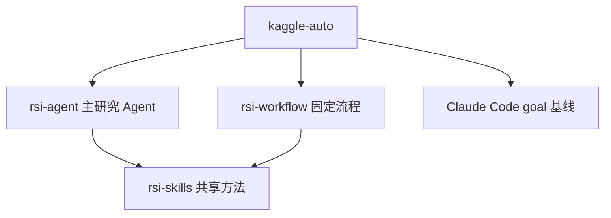

# 框架依赖与技能接入

## 所有权

| 仓库 | 拥有的内容 | 依赖 |
| --- | --- | --- |
| rsi-skills | 可复用原子/组合技能、整库快照、渐进加载 API | Python 标准库 |
| rsi-agent | 主 Agent、研究循环、P/U、任务与经验状态、原生会话恢复 | rsi-skills |
| rsi-workflow | 步骤调度、Solver/Optimizer、评分、预算、候选选择 | rsi-skills |
| kaggle-auto | 比赛准备、统一引擎协议、截止与平台提交 | 可选 rsi-agent/rsi-workflow 引擎；独立 goal 基线 |

主 Agent 按问题调用本库方法；固定工作流在指定 LLM 步骤加载方法。技能不改变执行权限、预算、评分器或封存数据边界。普通 Python Solver 不会直接执行 Markdown。主 Agent 规则保留在 rsi-agent 仓库，实际经验和任务产物不随本库发布。



## 安装依赖

两个框架在 pyproject.toml 声明 `rsi-skills>=0.2.1,<0.3`，通过各自的 `rsi-skills/` 子模块锁定完整库提交。先执行 `git submodule update --init --recursive`，再使用框架自己的环境：

```toml
[tool.uv.sources]
rsi-skills = { path = "rsi-skills", editable = true }
```

`uv sync --locked` 使用各自锁文件；发布时构建本库 wheel，再在调用方部署环境安装相同版本。Git 安装需由部署配置固定真实提交，不使用示例 SHA 充当已发布版本。kaggle-auto 通过引擎配置调用两个框架各自独立的解释器，默认 goal 项目不依赖 RSI 框架。四个仓库各自保留 Git 历史，任务启动不自动 clone 或安装依赖。本地 editable 源码由各仓库实际提交及 dirty 状态追溯；uv.lock 固定依赖解析，不能替代源码提交和运行快照的固定。

## 公共 API 0.2

```python
from pathlib import Path
from rsi_skills import catalog, fingerprint, install, open_snapshot

# 新任务：整库冻结到显式目录，不写全局配置。
snapshot = install(Path("/path/to/run/skills"))
# 需要严格 Git 固定时 install(..., expected_commit=真实完整提交)。
# dirty checkout 的本地开发允许冻结，并明确记录 source_dirty=true。

# 恢复：只打开原快照，不从当前源码重建。
snapshot = open_snapshot(Path("/path/to/run/skills"))
entries = snapshot.entries()
body = snapshot.read("rsi-using-skills", events=Path("/path/to/run/skill-events.jsonl"), scope="agent")

# 固定工作流：资源留在该步骤可见的工作区；只将所选正文放入上下文。
step = snapshot.stage(Path("/path/to/run/trial-0000"))
prompt = step.render(["rsi-solve-tabular-task"],
                     events=Path("/path/to/run/trial-0000/skill-events.jsonl"), scope="solver")
```

`entries()` 只返回摘要，不记录已加载。`read()` 成功读取后记录 skill.loaded；读取 references 等资源时记录 skill.resource_loaded。事件包含源提交、dirty 状态、技能目录哈希、资源哈希、快照身份和调用阶段。它证明加载器读取或向步骤提供了内容，不证明模型采纳方法或提高成绩。

`render()` 展开所选组合技能引用的原子技能，不展开入口的全部路由，也不预读全部 references。原子与组合仍共享同一任务、候选和 System 预算。

## 原生 Agent 的渐进加载

整库安装自带 `.rsi-runtime.py`，无需源 checkout 即可查询和读取：

```bash
python /path/to/run/skills/.rsi-runtime.py list
python /path/to/run/skills/.rsi-runtime.py read rsi-using-skills \
  --events /path/to/run/skill-events.jsonl --scope agent
python /path/to/run/skills/.rsi-runtime.py read rsi-kaggle-optimize \
  --resource references/regression-contract.md \
  --events /path/to/run/skill-events.jsonl --scope agent
```

框架负责将发现入口和读取命令提供给主 Agent；主研究规则由 rsi-agent 框架单独冻结。调用方不能仅复制目录就声称 Agent 已使用全部技能。

## 快照与恢复

整库安装包含所有 scripts/references、`.rsi-skills.json` 和受哈希管理的读取器。运行时按当前快照目录解析路径，快照可随工作区移动。安装清单仍保留与旧安装器兼容的绝对 path 字段；消费者使用 API 返回的当前路径，不能直接复用移动前的 path。

拥有运行目录的框架将快照身份写入自己的检查点；恢复前比对身份并验证文件。仅快照内部自带的哈希不构成安全边界。运行期间不更新快照，修改已冻结正文、参考或读取器时拒绝继续。安装器更新/卸载也会保留本地修改并报错。

库的指纹涵盖版本、来源提交/dirty 状态、技能内容与读取器，不依赖安装绝对路径。wheel 安装可能没有 Git 元数据，此时 source_commit/source_dirty 为 null；依靠锁定的分发版本、wheel 构建记录与内容哈希追溯，不伪造 Git 提交。执行依赖、网络、模型、训练、可信评分和提交工具始终由部署环境与任务框架提供。
